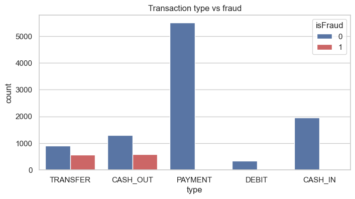
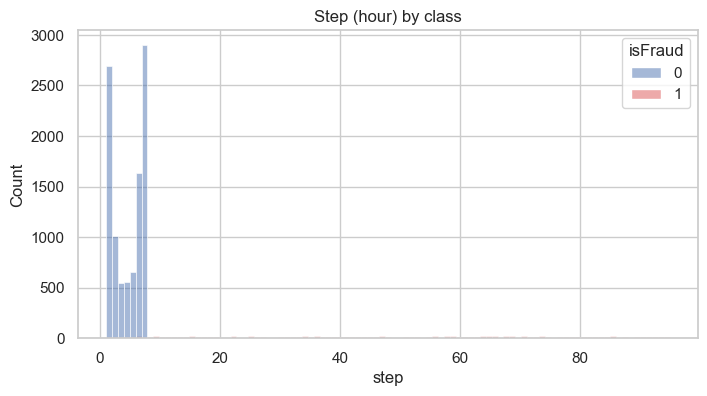
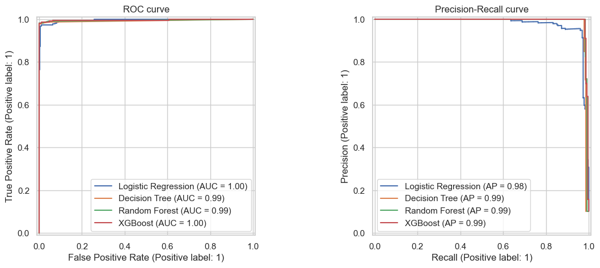
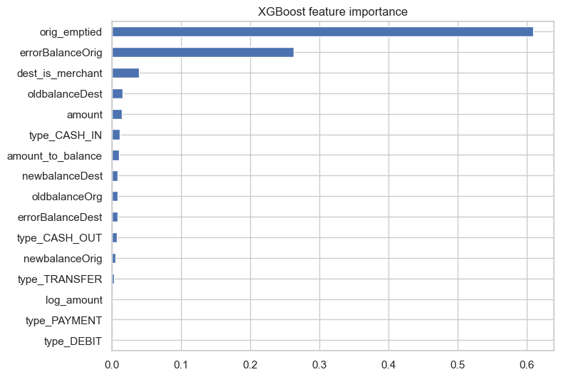

# Fraud Detection in Mobile-Money Transactions

A machine learning project that detects fraudulent mobile-money transactions, built as my capstone at **Boston Institute of Analytics**.

The final XGBoost model caught **224 of 228 frauds** on the test set with **1 false alarm** (F1 0.989). I then tested *why* the score was so high, and documented how far it can be trusted.

> **Note:** the data is a sample of [PaySim](https://www.kaggle.com/datasets/ealaxi/paysim1), a transaction **simulator**. No real customer data is used, and results describe this simulated sample, not real-world performance.

---

## Key results

| Metric (test set, 2,229 transactions) | Value |
|---|---|
| Precision | 0.996 |
| Recall | 0.982 |
| F1 score | 0.989 |
| ROC-AUC | 0.999 |
| Frauds caught / missed / false alarms | 224 / 4 / 1 |

Tuned XGBoost, threshold 0.5.

---

## The problem

In the simulation, fraud agents take control of an account, **transfer** the whole balance to another account, and **cash it out**. The goal is to score every transaction automatically, catching as much fraud as possible while letting honest customers through.

## Dataset

| | |
|---|---|
| Rows | 11,142 transactions |
| Columns | 10 |
| Fraud cases | 1,142 (10.25%) |
| Missing values / duplicates | 0 / 0 |

How these rows were sampled from PaySim is not documented. The sample has 10.25% fraud, far more than the full PaySim data (about 0.13%).

---

## What I found

### 1. Fraud appears only in TRANSFER and CASH_OUT



| Type | Normal | Fraud |
|---|---|---|
| CASH_IN | 1,951 | 0 |
| CASH_OUT | 1,293 | 578 |
| DEBIT | 346 | 0 |
| PAYMENT | 5,510 | 0 |
| TRANSFER | 900 | 564 |

### 2. Fraud drains the whole account

| Behaviour | Fraud | Normal |
|---|---|---|
| Sender balance is 0 afterwards | 99.2% | 40.3% |
| Amount equals the whole balance | 97.1% | 0.0% |
| Receiver is a merchant | 0.0% | 55.1% |

### 3. Data leakage in the `step` column



Every normal transaction is in hours 1-7, while fraud spans hours 1-95. A model could learn "late hour = fraud" and score well for the wrong reason. **I removed `step`**, along with the ID columns.

---

## Approach

1. **Feature engineering:** 16 features, including `orig_emptied`, `amount_to_balance`, `errorBalanceOrig`, `dest_is_merchant` and one-hot transaction type
2. **Stratified 80/20 split:** 8,913 training rows, 2,229 test rows
3. **Class imbalance:** class weighting (`scale_pos_weight` = 8.75 for XGBoost)
4. **Model selection:** 4 models compared with 5-fold cross-validation on the training set
5. **Tuning:** `RandomizedSearchCV` (25 combinations), then threshold choice from out-of-fold predictions

### Model selection (5-fold cross-validation, training set)

| Model | Precision | Recall | F1 | PR-AUC |
|---|---|---|---|---|
| Random Forest | 1.000 | 0.982 | 0.991 | 0.995 |
| **XGBoost** | 0.994 | 0.986 | 0.990 | 0.995 |
| Decision Tree | 0.988 | 0.987 | 0.987 | 0.981 |
| Logistic Regression | 0.664 | 0.982 | 0.792 | 0.970 |

XGBoost and Random Forest are almost tied. I chose **XGBoost** because it misses fewer frauds (13 vs 16), and catching fraud is the priority.



### What the model relies on



Two features, `orig_emptied` and `errorBalanceOrig`, give 87% of the importance. Both describe the account-draining pattern.

---

## Validation: why is the score so high?

| Check | Precision | Recall | F1 |
|---|---|---|---|
| All 16 features (test set) | 0.996 | 0.982 | 0.989 |
| Only data known before approval (test set) | 0.996 | 0.982 | 0.989 |
| **No balance features at all** (test set) | **0.361** | 0.982 | **0.528** |
| Hours 1-7 only (5-fold CV, 78 frauds) | 0.987 | 0.962 | 0.974 |
| Train hours 1-5, test 6-7 (34 frauds) | 0.944 | 1.000 | 0.971 |

**What this shows:**
- The model works with data available **before** a transaction is approved.
- The time bias does not explain the results, although those checks use few frauds.
- Without balance data, F1 falls to 0.528. **Performance depends on the balance-draining pattern** that PaySim uses to generate fraud, which may not exist in real data.

---

## Repository structure

```
Fraud_Detection/
├── Fraud_Detection_V1.ipynb        Analysis and modelling notebook
├── validation_checks.py            Extra validation checks
├── validation_results.json         Results of those checks
├── fraud_model_v1.pkl              Saved model, threshold and feature list
├── Fraud_Analysis_Dataset.csv      Dataset (PaySim sample)
├── description.txt                 Column descriptions
├── dashboard/                      Power BI dashboard (4 pages)
└── images/                         Charts used in this README
```

## How to run

```bash
pip install pandas numpy scikit-learn xgboost matplotlib seaborn joblib jupyter
```

1. Open `Fraud_Detection_V1.ipynb` and choose **Run All** (about one minute).
2. Run the extra checks:

```bash
python validation_checks.py
```

3. Open the dashboard: `dashboard/Fraud_Dashboard_V1.pbip` in Power BI Desktop (see `dashboard/README.md`).

### Score a new transaction

```python
import joblib, pandas as pd

art = joblib.load('fraud_model_v1.pkl')
# build_features() is defined in the notebook
X = build_features(pd.DataFrame([{
    'type': 'TRANSFER', 'amount': 181000.0,
    'oldbalanceOrg': 181000.0, 'newbalanceOrig': 0.0,
    'nameDest': 'C553264065', 'oldbalanceDest': 0.0, 'newbalanceDest': 0.0}]))[art['features']]
print(art['model'].predict_proba(X)[0, 1])   # about 0.9996, fraud
```

The saved file stores a threshold of 0.83. I recommend **0.5**, because a missed fraud costs more than a false alarm.

---

## Limitations

- Simulated data, and the sampling method is not documented
- 10.25% fraud here, against about 0.13% in the full PaySim data
- Results depend on the simulator's balance pattern
- The test set was viewed during earlier work, so it is not fully untouched
- Normal rows cover hours 1-7 only, so no long-term time test is possible

## Next steps

- Retest on the full PaySim data with a new holdout
- Validate on real transaction data
- Add customer-history features such as transaction velocity

---

## Tech stack

Python · Pandas · NumPy · Scikit-learn · XGBoost · Matplotlib · Seaborn · Power BI

## Author

**Gowtham**: Data Science capstone, Boston Institute of Analytics

[LinkedIn](https://www.linkedin.com/in/your-profile) · [GitHub](https://github.com/your-username)
